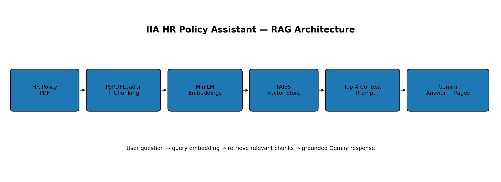

# IIA HR Policy Assistant — RAG Chatbot

A Retrieval-Augmented Generation (RAG) chatbot that answers questions about the Indian Industries Association (IIA) HR Policy using retrieved document passages. The chatbot uses LangChain, local sentence-transformer embeddings, FAISS, and Google Gemini.

Developed for the DataMites AI Engineering Track — AI Client Project 5.

## Problem statement

Employees and HR teams often need precise answers to questions about HR policies, such as leave, notice periods, transfers, and employee benefits. This project retrieves relevant passages from an HR policy document and provides grounded answers with page references. If the answer is not available in the retrieved context, the chatbot is instructed to say that it cannot find the answer in the document.

> **Document notice:** The source HR policy PDF is not included in this repository. Only upload or share that document if you have permission to do so.

## Architecture



1. Load the HR policy PDF with `PyPDFLoader`.
2. Split the extracted text into overlapping chunks (800 characters, 150-character overlap).
3. Create embeddings using `sentence-transformers/all-MiniLM-L6-v2`.
4. Store the embeddings in a FAISS vector index.
5. Embed the user's question and retrieve the top 4 relevant chunks.
6. Add the retrieved passages to a grounded prompt.
7. Generate an answer with Google Gemini and show the source page references.

## Technology stack

| Component | Technology |
|---|---|
| Language | Python |
| Orchestration | LangChain |
| PDF ingestion | PyPDFLoader |
| Text splitting | RecursiveCharacterTextSplitter |
| Embeddings | Sentence Transformers — all-MiniLM-L6-v2 |
| Vector store | FAISS |
| LLM | Google Gemini |
| Evaluation | RAGAS and custom retrieval metrics |
| Interface | Notebook CLI; Streamlit app code is also generated by the notebook |

## Repository files

| File | Description |
|---|---|
| `RAG_proj_final.ipynb` | End-to-end RAG pipeline, testing, evaluation, and project documentation |
| `README.md` | Project overview and setup instructions |
| `requirements.txt` | Python dependencies |
| `architecture.png` | RAG architecture diagram |
| `.gitignore` | Files and secrets excluded from Git |

The notebook generates the FAISS index and evaluation output files when run. These generated files are not required to be committed if they can be reproduced from the notebook and source PDF.

## Setup

- Python 3.10 or later is recommended.
- Google Colab is the easiest way to run the notebook.
- Install dependencies:

```bash
pip install -r requirements.txt
```

- Create a Gemini API key in [Google AI Studio](https://aistudio.google.com/apikey). Do not put the key in the notebook or commit it to GitHub.

## Run the project

1. Open `RAG_proj_final.ipynb` in Google Colab or Jupyter.
2. Run the cells in order.
3. Enter your Gemini API key when prompted (the notebook uses hidden input).
4. Upload the HR policy PDF when the notebook asks for it.
5. Run the evaluation cells to reproduce the retrieval and RAGAS results.
6. Use the notebook's chat interface to ask questions about the policy.

## Evaluation results

The submitted notebook records the following results for its 17-question evaluation set (14 in-domain and 3 out-of-domain questions):

| Metric | Recorded result |
|---|---:|
| Retrieval Hit@4 | 100% |
| Mean Reciprocal Rank (MRR) | 0.917 |
| RAGAS Faithfulness | 0.929 |
| RAGAS Answer Relevancy | 0.719 |
| RAGAS Context Precision | 0.798 |
| RAGAS Context Recall | 0.851 |
| Out-of-domain refusal | 3/3 |
| In-domain false refusals | 1/14 |

These are the notebook's recorded evaluation outputs, not a guarantee of performance on every document or query. One in-domain question was incorrectly refused, so prompt and refusal behaviour can be improved further.

## Limitations and future improvements

- Improve answer relevancy and reduce false refusals for questions that are present in the policy.
- Evaluate on a larger and more diverse question set.
- Consider semantic or structure-aware chunking for complex policy sections.
- Add a polished Streamlit interface and deployment workflow.
- Re-run evaluation whenever the source policy is updated.
